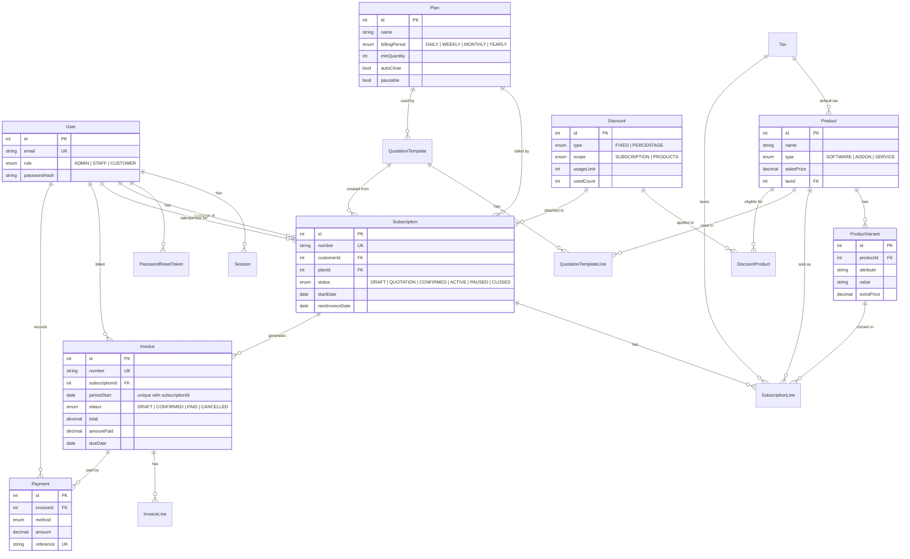

# Brightloop

Brightloop is the subscription management system for **Brightloop Software**, built for the Odoo hackathon brief *Subscription Management System*. It replaces Brightloop's spreadsheet with one app for products, plans, quotations, subscriptions, recurring invoices, payments and revenue reporting. It has a public landing page, separate dashboards for admins and staff, and a self-service portal for customers.

- **[Judge demo script](docs/DEMO.md)**: a 7-minute walkthrough of the brief's scenes, with logins and clicks.
- **[Roles and permissions](docs/ROLES.md)**: what Admin, Staff and Customer can each see and do.

There are no third-party APIs. Auth, billing, taxes and discounts are all our own code. Payments are recorded by the team, or paid by the customer in the portal through Demo Pay, a built-in simulated card and UPI checkout (no real payment gateway). Emails go through SMTP when it is configured or are printed to the server console when it isn't.

## What's in the app

- **Brand.** The Brightloop logo and the colours and fonts from the brief: Odoo purple `#714B67`, grey `#8F8F8F`, highlighter yellow `#FBB130`, Caveat for display headings and Inter for body text.
- **Public landing page at `/`.** How it works, portal features, live plans and prices from the catalog, and an FAQ. **Log in** opens a login modal on the page (`/login` still works for direct links). `/pricing` lists every plan and product on sale.
- **Customer self-signup with approval.** Anyone can sign up as a customer at `/signup`, but the account can't log in until an admin or staff member approves it. Pending signups show up on the staff dashboard and under **Customers → Waiting for approval**.
- **Admin dashboard and Staff dashboard.** Both live at `/dashboard`. Admins get the business overview: MRR, revenue, outstanding and overdue amounts, a revenue chart and setup counts. Staff get a work queue: signups to approve, quotation requests from the portal, overdue invoices to chase, drafts to confirm, open quotations, subscriptions expiring soon and today's payments.
- **Staff page vs Customers page.** **Staff** (`/dashboard/users`, admin only) lists the team, admins and staff, and is where the admin adds staff and switches roles. **Customers** (`/dashboard/customers`, admin and staff) lists customer accounts, with the approval queue.
- **Customer portal at `/portal`.** Customers browse products, plans on sale and ready-made packages under **Products** and request a quotation (staff review it, then send it), see their subscriptions and invoices, pause, resume, renew or cancel when the plan allows it, pay open invoices by card or UPI with Demo Pay, print invoices and receipts, and edit their profile.

## Features by scene

| Scene from the brief | What Brightloop does |
|---|---|
| **1. A new customer signs up** | Sign up, log in and log out. One account per email. Passwords need more than 8 characters, an uppercase letter, a lowercase letter and a special character, with a live checklist on the form and the same check on the server. Passwords are stored as bcrypt hashes. Sessions use an httpOnly cookie, and only the SHA-256 hash of the session id is stored in MySQL. Forgot password sends a single-use reset link that expires in 30 minutes. There are three roles (Admin, Staff, Customer), and only the admin can add staff. Customers can sign up themselves, but they can't log in until an admin or staff member approves the account on the Customers page or from the staff dashboard (they get an email when it's approved). A pending signup can also be rejected. Only admins and staff can bill customers. |
| **2. Launching a new plan** | Products (Software / Add-on / Service) with sales price, cost price and default tax. Variants add an extra price, e.g. Brand = Odoo adds ₹560. Plans have a daily, weekly, monthly or yearly period, a minimum quantity, availability dates, and options for auto-close, close early, pause and renew. |
| **3. Turning a quote into a subscription** | Quotation templates (plan, lines, validity in days). A new subscription can start from a template. Subscriptions get numbers like `SUB-00001` and have a customer, plan, start and expiry dates, payment terms, salesperson, and lines with variant, quantity, unit price and tax. Status flow: Draft → Quotation → Confirmed → Active → Closed, plus Paused. An expired quotation can't be confirmed. |
| **4. Billing day** | The **Run billing now** button on the Invoices page calls `runBilling()`, and a scheduler in the server runs it every day after 00:05 IST (`BILLING_SCHEDULER` in `.env`). Every run is listed under **Billing runs**. It activates confirmed subscriptions that have started and creates one draft invoice per due period for every active subscription, with lines, tax and discount filled in. A subscription that is behind gets one invoice for each missed period, and an invoice is never created twice (see below). Plans with auto-close close the subscription when it expires. Invoices can be confirmed one by one or all at once, cancelled, and printed (or saved as PDF). |
| **5. A customer asks for a better price** | Admin-only discount rules: fixed or percentage, minimum purchase or quantity, start and end dates, usage limit, scoped to specific products or the whole subscription. The billing run applies them automatically, and only one discount applies per invoice: the one that saves the most. A discount stops applying after its end date or once `usedCount` reaches its usage limit. |
| **6. The money comes in** | Staff record payments by cash, bank transfer, card, UPI or cheque, and partial payments are allowed. Customers can pay an open invoice themselves in the portal by card or UPI through Demo Pay, then print a receipt. The invoice becomes **Paid** when `amountPaid` reaches the total. Invoices can be filtered by paid, outstanding or overdue (confirmed, not fully paid, past the due date). |
| **7. The finance lead at month end** | The admin dashboard shows active subscriptions, MRR, revenue this month, outstanding and overdue amounts, and a 6-month revenue chart. Reports have Subscriptions, Invoices, Payments and Overdue tabs, filter by date, status, customer and plan, and export to CSV. Lists show 25 rows per page and totals are computed in SQL, so pages stay fast with the 2,000+ seeded subscriptions. |

## Tech stack

- **Next.js 16** (App Router, server actions) with **TypeScript**
- **Tailwind CSS 4**, **shadcn/ui** components and **React Bits** animations
- **Prisma 6** ORM on **MySQL 8**, with the SQL migrations committed
- `bcryptjs` for password hashes, `nodemailer` for optional SMTP, `zod` for validation
- Tests use Node's built-in test runner through `tsx`

## Setup

You need Node.js 20 or later and Docker. On macOS, Colima works in place of Docker Desktop (`colima start`).

```bash
docker compose up -d          # MySQL 8 on localhost:3306 (container subflow-mysql)
cp .env.example .env          # DATABASE_URL, APP_URL, optional SMTP settings
npm install
npx prisma migrate deploy     # create the tables
npm run db:seed               # base data: company, one admin, one staff, catalog
npm run db:seed:demo          # optional: ~300 demo customers and billing history (about 2 seconds)
npm run dev                   # http://localhost:3000
```

To send real emails, set `SMTP_HOST` and the other SMTP values in `.env`. If you leave them empty, password reset and account approval emails are printed to the terminal running `npm run dev`.

## Demo logins

The seed creates one admin and one staff member, both with the password **`Demo@12345`**. For a guided walkthrough, see [docs/DEMO.md](docs/DEMO.md).

| Role | Email | Notes |
|---|---|---|
| Admin | `admin@brightloop.test` | Admin dashboard. Everything, including staff, catalog, discounts and settings. Only the admin adds more staff, from the **Staff** page |
| Staff | `staff@brightloop.test` | Staff dashboard. Day-to-day work: approvals, quotations, billing, payments |

Customers sign up themselves from the landing page and log in once staff approve them under **Customers**.

### What the seed creates

`npm run db:seed` (`prisma/seed.ts`) creates the Brightloop company settings (GSTIN, INR, invoice prefix `INV`), the admin and staff accounts above, GST 18% and GST 5%, the products and variants (Brightloop CRM ₹999 with Brand Odoo +560, Brightloop Accounting ₹1,499 with Edition Pro +500, Extra Storage, Priority Support, Extra User Seat), the plans (Monthly, Yearly, Weekly Trial, Team Seats with a minimum quantity of 5), two discounts and two quotation templates. It creates no customers, subscriptions or invoices.

`npm run db:seed:demo` adds demo data to show the app at scale:

- The demo customer `customer@brightloop.test` (Kiran Stores) with an active monthly CRM, a yearly Accounting Pro and an open quotation
- Two signups waiting for approval (`farah@inkwellstudio.test`, `tenzin@himalayantrails.test`)
- About 300 Indian small-business customers
- 2,223 subscriptions across every status, with start dates spread over the last 8 months
- About 6,500 invoices
- About 5,800 payments, including partial payments, with a realistic number of invoices left outstanding or overdue

The invoices are worked out with the real billing engine (`calculateInvoice`, `duePeriods`, discount usage limits) in the order a daily billing run would have created them. So the totals, `Discount.usedCount` and `nextInvoiceDate` all agree, and running billing straight after seeding creates nothing new.

Random data comes from a seeded generator, so every fresh database gets the same data. Both commands are safe to run again: the base records are upserted, and the bulk data is skipped once there are 2,000 or more subscriptions.

## Project structure

```
prisma/
  schema.prisma          data model
  migrations/            SQL migrations (MySQL)
  seed.ts                Brightloop demo data
src/
  app/
    page.tsx             public landing page (login modal in _landing/)
    pricing/             public pricing page
    (auth)/              login, signup, pending approval, forgot / reset password
    dashboard/           admin and staff: admin-home.tsx and staff-home.tsx, customers,
                         users (the Staff page), products, plans, taxes, discounts, templates,
                         subscriptions, invoices, payments, billing-runs, reports, settings
    portal/              customer portal: overview, subscriptions, invoices, Demo Pay checkout, profile
  components/            shared UI kit, Brightloop logo (brand.tsx), shadcn/ui in ui/, React Bits in reactbits/
  lib/
    auth.ts, account-approval.ts, password.ts, password-reset.ts, mail.ts, money.ts, db.ts
    catalog/             product, variant, plan, tax and discount helpers
    subscriptions/       status flow, numbering, dates, templates, totals
    billing/             pure billing engine (periods, discounts, tax, totals), run.ts (billing run),
                         payments and Demo Pay
    jobs/                daily billing scheduler
    reports/             dashboard queries, report filters, CSV export
docs/                    demo script, roles, build plan and per-module notes
```

## How MySQL enforces the key rules

| Rule | Enforced by |
|---|---|
| One account per email | `User.email` unique index (`User_email_key`) |
| Unique subscription and invoice numbers | `Subscription.number` and `Invoice.number` unique indexes. Numbers come from the auto-increment id inside the same transaction |
| No double billing | `Invoice` unique key on `(subscriptionId, periodStart)`. Each period is billed in its own transaction, a duplicate-key error (P2002) is treated as "already billed", and `nextInvoiceDate` only ever moves forward |
| A payment is never recorded twice | `Payment.reference` unique index on the payment reference |
| No duplicate variant | `ProductVariant` unique key on `(productId, attribute, value)` |
| Discount usage limit | `usedCount` is incremented with a conditional `UPDATE … WHERE usedCount < usageLimit` in the same transaction as the invoice |
| Fast lists and reports | Indexes on `Subscription(status)`, `(customerId)` and `(nextInvoiceDate)`; `Invoice(status)`, `(customerId)` and `(dueDate)`; `Payment(invoiceId)` and `(paymentDate)`; `User(role)` |
| Integrity | Foreign keys with cascade or set-null. Money is `DECIMAL(12,2)` and tax rates are `DECIMAL(5,2)` |

## Data model



`CompanySettings` is a single row (id 1) holding Brightloop's name, address, GSTIN, currency and invoice prefix, and it is printed on every invoice.

## Team

| GitHub | Built |
|---|---|
| [AHDCREW](https://github.com/AHDCREW) | Core: auth, roles, dashboard, reports |
| [Farisebnuyousuf](https://github.com/Farisebnuyousuf) | Catalog, pricing, landing page, brand |
| [muhammedshafykm-ops](https://github.com/muhammedshafykm-ops) | Subscriptions, quotation templates, customer portal |
| [rejanoorjahan-ship-it](https://github.com/rejanoorjahan-ship-it) | Billing, invoices, payments, role dashboards |

## Testing

```bash
npm test            # unit tests: billing engine, payments and Demo Pay, subscriptions, billing scheduler
npm run typecheck   # tsc --noEmit
npm run lint
```

The billing engine in `src/lib/billing/` is pure TypeScript with no database access (only `run.ts` and `record-payment.ts` talk to MySQL). The tests in `src/lib/billing/*.test.ts` cover period maths (month-end clamping, missed periods, expiry), discount rules (limits, dates, scope, allocation), per-line tax and rounding, so invoice totals always equal the sum of their lines.
